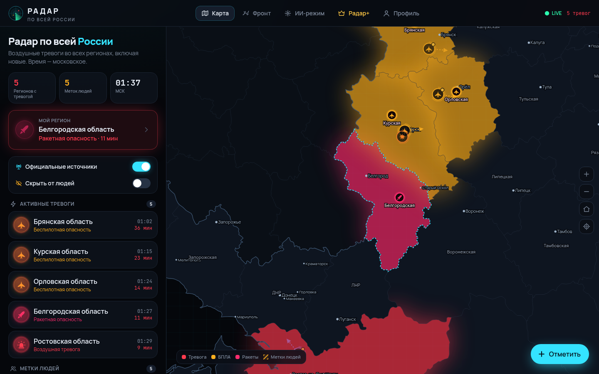
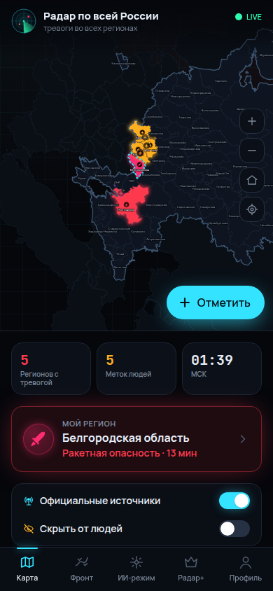
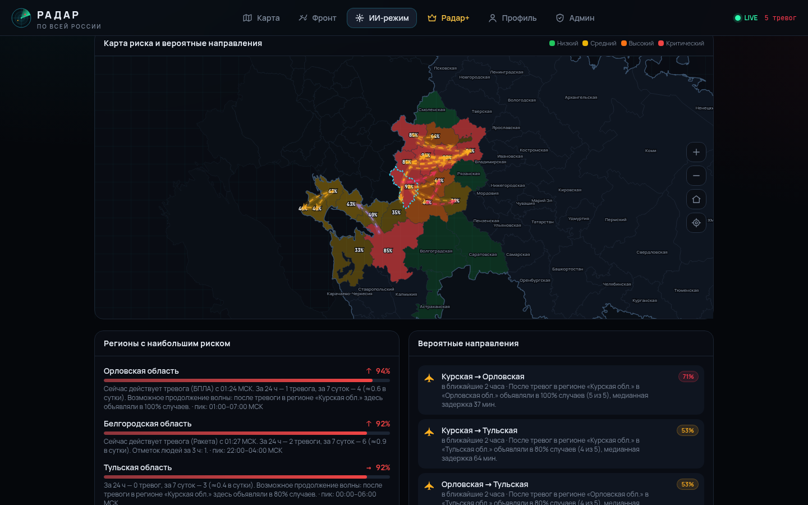
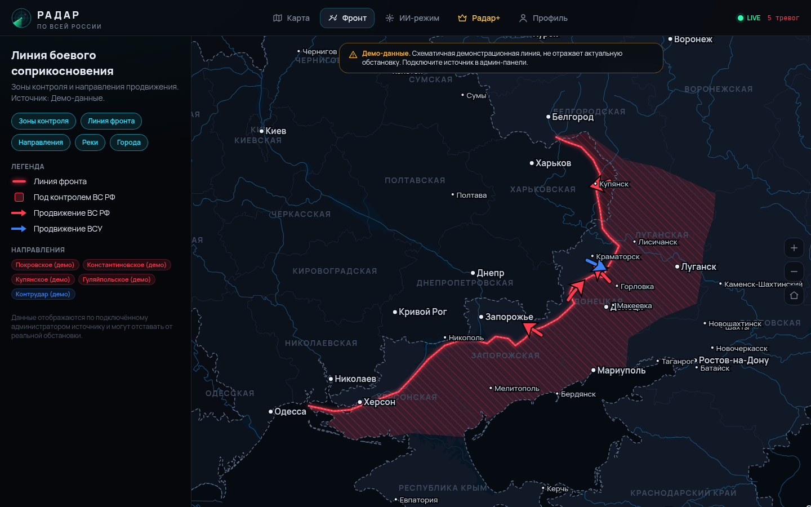
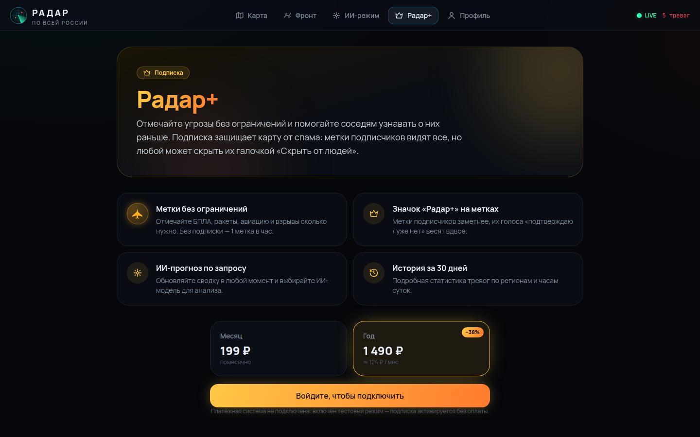
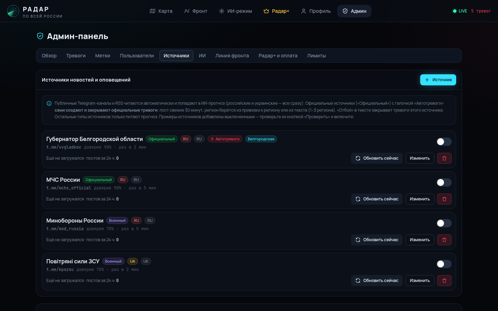

# Радар по всей России

PWA-приложение для оповещения о воздушных угрозах: тревоги во всех 89 регионах (включая Крым, Севастополь, ДНР, ЛНР, Запорожскую и Херсонскую области), метки людей о БПЛА и ракетах, карта линии фронта и ИИ-прогноз. Тёмный интерфейс, карты нарисованы на SVG (d3-geo), уведомления приходят через Web Push на iPhone и Android.

> Радар не заменяет официальные средства оповещения. Если звучит сирена или пришло сообщение МЧС, действуйте по инструкции.

## Скриншоты

| Карта тревог | Телефон | ИИ-режим |
| --- | --- | --- |
|  |  |  |
| **Линия фронта (демо-данные)** | **Радар+** | **Админка: источники** |
|  |  |  |

## Возможности

| Раздел | Что умеет |
| --- | --- |
| **Карта** | Регионы с активной тревогой подсвечиваются и пульсируют. Метки людей показаны иконками: БПЛА, ракета, авиация, взрывы, другое. Есть направление движения, «кольцо жизни» и плавное затухание. Работают зум и пинч, карточка региона показывает статистику по часам. |
| **Фильтры** | **«Официальные источники»** включает и выключает официальные тревоги. **«Скрыть от людей»** прячет все метки пользователей. |
| **Метки** | Пользователь выбирает тип, точку на карте или «Я здесь», направление, количество и комментарий. Без подписки — **1 метка в час**, с **Радар+** — без ограничений (защита от спама: 20 в час). |
| **Исчезновение меток** | У каждого типа своё время жизни (БПЛА 25 мин, ракета 10, авиация 15, взрывы 20; настраивается). «Подтверждаю» продлевает метку, но не дольше чем до ×3 от базового времени. Достаточно голосов «Уже нет» скрывают её сразу. Голоса подписчиков Радар+ весят ×2. Официальная тревога без отбоя закрывается через 6 ч. |
| **Линия фронта** | Зоны контроля, линия соприкосновения, стрелки продвижения, реки и города, как в DeepState. Данные импортируются из GeoJSON по URL с автообновлением, загружаются файлом или правятся в админке. |
| **ИИ-режим** | Алгоритм считает все тревоги и метки по регионам: частоты, тренды, пиковые часы, «волны» тревог от региона к региону, векторы по меткам. LLM читает российские и украинские источники и выдаёт сводку на сегодня и завтра, риск по регионам и вероятные направления (стрелки на отдельной карте). Можно выбрать модель. Точность прогнозов оценивается (Brier score), и эта статистика возвращается в промпт модели. |
| **Уведомления** | Web Push по выбранному региону и ещё до 4 дополнительных. На Android приходит вибро-паттерн, при открытом приложении звучит короткая сирена (~2 с, WebAudio). Тревоги можно полностью отключить или настроить по типам. |
| **Аккаунт** | Регистрация, вход, личный кабинет: регионы, уведомления, мои метки, платежи, смена пароля, удаление аккаунта. |
| **Радар+** | Подписка через ЮKassa на месяц или год. Без настроенной оплаты работает тестовый режим (только в dev). |
| **Админ-панель** | Обзор, тревоги (объявить или дать отбой с push-рассылкой), модерация меток, пользователи (роли, бан, выдача Радар+), источники (Telegram и RSS), ИИ (провайдеры по API-ключу и base URL, модели, промпт, история и точность), линия фронта, оплата, лимиты. |

## Стек

- **Сервер:** Node.js 22+, [Hono](https://hono.dev), SQLite (better-sqlite3, WAL), web-push (VAPID), zod. Реальное время через SSE (`/api/stream`).
- **Клиент:** React 19, Vite, Tailwind CSS 4, d3-geo и d3-zoom (SVG-карты), PWA (manifest и service worker).
- **Геоданные:** Natural Earth (public domain) собираются скриптом `npm run geo` в `web/public/geo/*.topo.json` и `shared/regions.json`.

## Быстрый старт

```bash
npm install
cp .env.example .env            # заполните ADMIN_EMAIL / ADMIN_PASSWORD
npm run seed:demo               # необязательно: демо-тревоги и метки для разработки
npm run dev                     # API :8787 + Vite :5173
```

Откройте http://localhost:5173. Администратор создаётся при старте из `ADMIN_EMAIL`/`ADMIN_PASSWORD`; кроме того, есть `npm run admin -- promote you@mail.ru`.

### Продакшен

```bash
npm run build && npm start      # один процесс: API + статика из dist/web
# или
docker compose up -d --build
```

Обязательно:
- **HTTPS.** Без него не работают Web Push и установка PWA. Поставьте nginx или Caddy перед `:8787`. Для SSE отключите буферизацию: `proxy_buffering off` (заголовок `X-Accel-Buffering` уже отправляется).
- `PUBLIC_URL`: нужен для возврата после оплаты.
- `APP_SECRET`: им шифруются API-ключи и секрет ЮKassa в базе. Сгенерируйте `openssl rand -hex 32` и не меняйте после запуска.
- Регулярно бэкапьте `DATA_DIR` (`radar.db`).

## Настройка в админ-панели

1. **ИИ → провайдеры.** Добавьте base URL и API-ключ любого OpenAI-совместимого API: OpenAI, OpenRouter, DeepSeek, локальный Ollama или vLLM, другие. Затем «Загрузить модели», отметьте нужные и назначьте модель по умолчанию. Пользователи выберут модель в ИИ-режиме, если это разрешено в настройках. Своим текстом можно дополнить системный промпт.
2. **Источники.** Подключаются публичные Telegram-каналы (через `t.me/s/…`) и RSS. Официальный канал, привязанный к региону, с включёнными «автотревогами» сам объявляет тревогу и даёт отбой по ключевым словам («беспилотная опасность», «ракетная опасность», «отбой»…). Остальные источники (российские и украинские) идут в ИИ-анализ. При первом запуске создаются примеры: они **выключены**, проверьте их кнопкой «Проверить».
3. **Линия фронта.** Пока источник не подключён, показана **демонстрационная** схематичная линия с явной пометкой. Укажите URL GeoJSON (FeatureCollection; полигоны с `properties.kind`: `occupied | gray | liberated | contested`, линии — линия фронта, линии с `kind: "arrow"` — стрелки) или загрузите файл. Используйте источники, на данные которых у вас есть права.
4. **Радар+ и оплата.** Укажите цены, `shopId` и секретный ключ ЮKassa. В кабинете ЮKassa задайте адрес уведомлений `https://ваш-домен/api/billing/webhook/yookassa`. Каждый платёж перед активацией перепроверяется через API ЮKassa.
5. **Лимиты.** Здесь настраиваются интервал для бесплатных меток, антиспам Радар+, время жизни меток, порог «Уже нет» и автоотбой.

## Уведомления на телефоне

- **iPhone (iOS 16.4+):** Safari → «Поделиться» → «На экран „Домой“», затем откройте Радар с иконки и нажмите «Включить уведомления».
- **Android:** Chrome → «Установить приложение» (или просто разрешите уведомления).
- **Ограничение платформ:** Web Push не позволяет задать свой звук уведомления. Когда приложение закрыто, играет системный звук; на Android добавляется вибро-паттерн, и уведомление о тревоге не исчезает само (`requireInteraction`). Короткая сирена звучит, когда приложение открыто. Отдельный «звонок» для закрытого приложения возможен только в нативной обёртке (Capacitor и т. п.).

## Структура

```
server/            API (Hono): маршруты, сервисы, БД, планировщики
  services/ai/       аналитика, эвристический прогноз, LLM-клиент, промпт, оценка точности
  services/sources/  загрузка Telegram/RSS, разбор сигналов (RU/UK), автотревоги
shared/            типы, константы, регионы и города (общие для сервера и клиента)
web/               React-приложение (Vite root), public/: sw.js, manifest, иконки, geo
scripts/           сборка сервера, иконок и геоданных
```

## Проверки

```bash
npm run typecheck
npm test
npm run build
```
